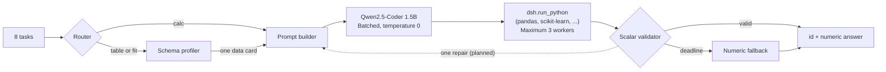

# Recommended architecture

Use a compact hybrid architecture in which the LLM interprets each objective and deterministic tools perform the computation.

Load `Qwen2.5-Coder-1.5B-Instruct` once. 
-A rule-based router uses file presence and regression phrases to select `calc`, `table`, or `fit`. 
-For tasks attaching files, a deterministic schema profiler creates a data card (a presentation of all attached files structure and content). 
This data card contains the raw `data_dictionary.csv`, each file's shape, separator, decimal format, column names, observed missing-value token, and the first two or three raw sample rows.
Missing-value counts and row positions are not sent to the LLM; generated pandas code locates and handles missing values according to the objective. The profiler does not perform semantic column selection: the LLM uses the objective and raw data dictionary to determine which physical columns are relevant.

Batch all eight objectives and data cards into one GPU generation pass at temperature zero. Request only a short Python program producing one scalar. Execute it through `dsh.run_python`, with SymPy/NumPy for calculations, pandas for cleaning, filtering and joins, and scikit-learn for OLS or unregularized logistic regression. The LLM therefore interprets language; trusted libraries perform the arithmetic.

A final gate accepts only one finite number. *(Planned validation will also check integer, probability, and rounding requirements.)* Run execution across three CPU workers, isolate every task, maintain a deadline margin, and always return a numeric fallback. This five-module design is small, explainable, fast, and more general than templates or fine-tuning only 180 examples.

*(A planned repair pass will use the traceback and schema to retry syntax, runtime, or malformed-output failures in one batch.)*

